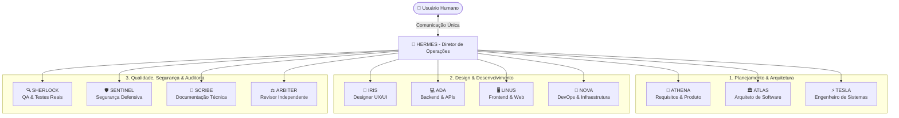

# 🏢 HERMES AI TEAM — Team Builder v1.0.0

[](https://hermes-agent.nousresearch.com)
[](#)
[](#)
[](#)

Construtor e instalador automatizado de organização multiagentes para o **Hermes Agent** (Nous Research).

O **HERMES AI TEAM** transforma o seu Hermes Agent em uma verdadeira empresa de engenharia de software autônoma. Em vez de conversar com 11 bots disputando sua atenção, você interage exclusivamente com o **HERMES** (Diretor de Operações), que analisa a demanda, decompõe o escopo e coordena 11 especialistas técnicos com identidades, personas (`SOUL.md`), responsabilidades e critérios de qualidade rigorosos.

---

## ⚡ Instalação Rápida em 1 Linha

### No Windows (PowerShell):
```powershell
irm https://raw.githubusercontent.com/alexbuzatto/hermes-team-builder/main/install.ps1 | iex
```
*Ou clonando o repositório localmente:*
```powershell
git clone https://github.com/alexbuzatto/hermes-team-builder.git
cd hermes-team-builder
.\install.ps1
```

### No Linux / WSL2 / macOS (Bash):
```bash
curl -fsSL https://raw.githubusercontent.com/alexbuzatto/hermes-team-builder/main/install.sh | bash
```
*Ou clonando o repositório localmente:*
```bash
git clone https://github.com/alexbuzatto/hermes-team-builder.git
cd hermes-team-builder
chmod +x install.sh
./install.sh
```

---

## 🏛️ Arquitetura da Organização



---

## 👥 Os 12 Especialistas

| # | Agente | Profile | Tier de Modelo | Especialidade & Responsabilidade Principal |
| :-: | :--- | :--- | :--- | :--- |
| **01** | **HERMES** | `default` | 🧠 Premium | **Diretor de Operações**: Orquestração geral, decomposição de tarefas e único ponto de contato com o usuário. |
| **02** | **ATHENA** | `athena` | 🧠 Premium | **Produto & Requisitos**: Histórias de usuário, critérios de aceitação e definição de escopo (MVP). |
| **03** | **ATLAS** | `atlas` | 🧠 Premium | **Arquiteto de Software**: Stack tecnológica, modelagem de dados, Clean Architecture e ADRs. |
| **04** | **TESLA** | `tesla` | ⚙️ Intermediário | **Engenheiro de Sistemas**: Contratos de API, mensageria, resiliência, latência e integrações inter-serviços. |
| **05** | **ADA** | `ada` | ⚙️ Intermediário | **Desenvolvedora Backend**: Lógica de negócio, endpoints REST/GraphQL, persistência e testes unitários. |
| **06** | **LINUS** | `linus` | ⚙️ Intermediário | **Desenvolvedor Frontend**: Interfaces web responsivas, componentes acessíveis e consumo de APIs. |
| **07** | **IRIS** | `iris` | ⚙️ Intermediário | **Designer UX/UI**: Jornadas de usuário, design systems, tokens visuais (cores/tipografia) e wireframes. |
| **08** | **SHERLOCK**| `sherlock` | ⚡ Econômico | **Engenheiro de QA**: Caça de defeitos, testes de integração/regressão e validação com logs reais. |
| **09** | **SENTINEL**| `sentinel` | 🧠 Premium | **Segurança Defensiva**: Auditoria OWASP Top 10, sanitização, prevenção de vazamento de credenciais e CVEs. |
| **10** | **NOVA** | `nova` | ⚡ Econômico | **DevOps & Infra**: Docker, Docker Compose, pipelines CI/CD, monitoramento e planos de rollback. |
| **11** | **SCRIBE** | `scribe` | ⚡ Econômico | **Documentação Técnica**: Manuais de instalação, READMEs, documentação de APIs e changelogs. |
| **12** | **ARBITER** | `arbiter` | 🧠 Premium | **Revisor Técnico Independente**: Auditoria final de código, conformidade de requisitos e parecer vinculante. |

---

## 🚦 Regras Invioláveis de Colaboração (Protocolo AGENTS.md)

1. **Zero Simulação:** Nenhum agente tem permissão para inventar comandos, inventar saídas de terminal ou afirmar que um teste passou sem executá-lo de verdade.
2. **Evidência Obrigatória:** Qualquer entrega técnica requer comprovação através de caminhos de arquivos criados e saídas de logs reais.
3. **Portal de Confirmação Humana:** Ações destrutivas (exclusão de arquivos, alterações em bancos de produção, deploy externo ou consumo de APIs pagas) **exigem autorização explícita do usuário**.
4. **Veredito do Arbiter:** O HERMES não libera uma entrega para o usuário sem a aprovação técnica independente do ARBITER.

---

## 🛠️ Ferramentas e Scripts do Repositório

```text
hermes-team-builder/
├── manifest.yaml            # Definição declarativa dos 12 agentes e tiers
├── manifest.json            # Versão compilada para zero dependências
├── install.ps1              # Atalho de instalação para Windows
├── install.sh               # Atalho de instalação para Linux/macOS
├── installer/
│   ├── install.ps1          # Instalador completo para Windows
│   ├── install.sh           # Instalador completo para Linux
│   ├── repair.ps1           # Repara e atualiza SOUL.md sem perder dados
│   ├── repair.sh            # Repara e atualiza SOUL.md no Linux
│   ├── uninstall.ps1        # Desinstalação segura dos perfis
│   └── uninstall.sh         # Desinstalação segura no Linux
├── core/
│   ├── detect_environment.py# Detecção automática de SO, paths e Hermes
│   ├── profile_manager.py   # Gerenciador de criação e sync de profiles
│   ├── model_manager.py     # Gestor de modelos por tier (Premium/Intermed/Eco)
│   ├── delegation_manager.py# Configuração de roteamento semântico e kanban
│   ├── backup_manager.py    # Backups timestamped automáticos
│   └── validator.py         # Diagnóstico completo com matriz visual
├── agents/                  # 12 Personas completas com contratos
│   ├── hermes/SOUL.md
│   ├── athena/SOUL.md
│   └── ...
├── protocols/               # Protocolos de qualidade e segurança
│   ├── AGENTS.md
│   ├── delegation.yaml
│   ├── quality.yaml
│   └── security.yaml
└── tests/                   # Testes automatizados de integridade
    └── test_installation.py
```

---

## 💬 Como Usar Após a Instalação

Abra o terminal e inicie o chat com o Hermes:
```bash
hermes chat
```

Envie um comando de exemplo para testar a orquestração da equipe:
```text
HERMES, preciso desenvolver uma API de gerenciamento de tarefas com autenticação JWT.
Convoque a ATHENA para elencar os requisitos e o ATLAS para modelar a arquitetura e banco de dados.
Apresente o planejamento inicial antes de iniciarmos o código.
```

O **HERMES** assumirá o comando e coordenará os especialistas automaticamente!

---

## 📄 Licença
Distribuído sob licença MIT. Consulte `LICENSE` para mais informações.
